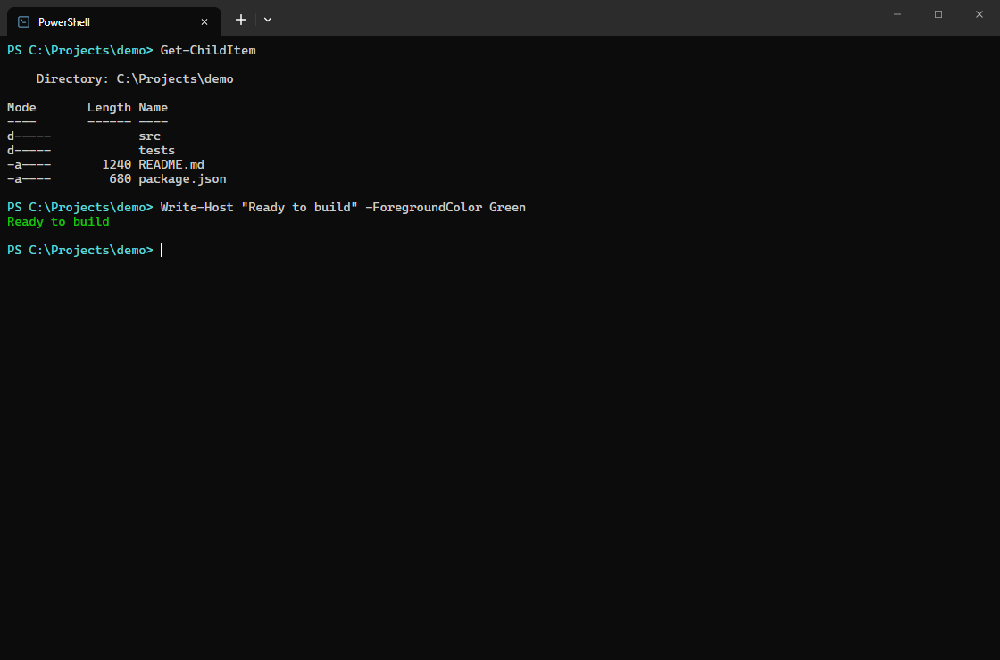
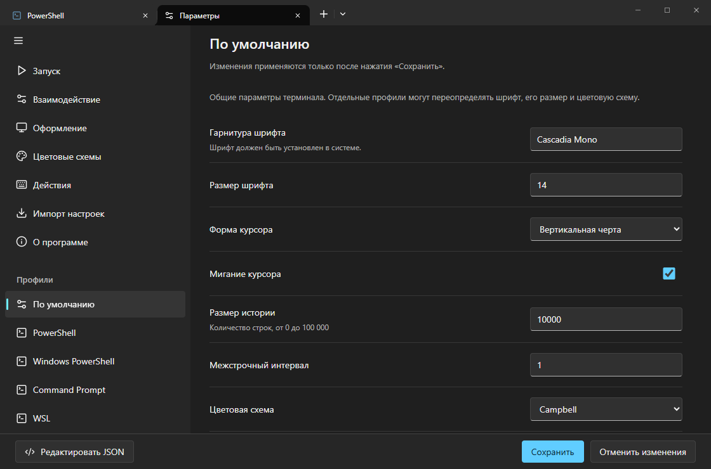
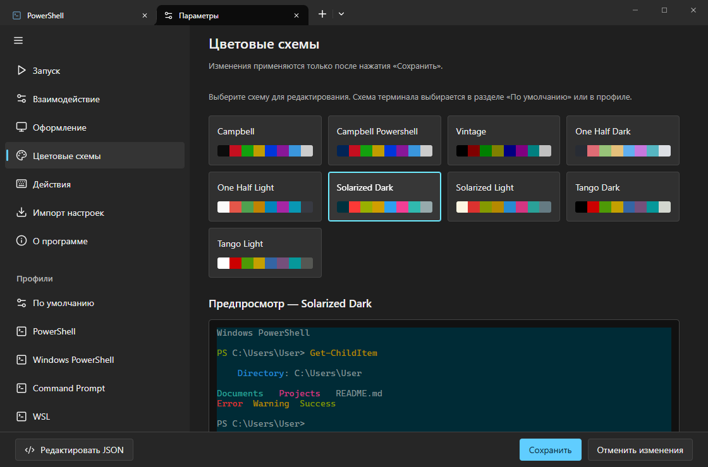

# OpenTerminal

Компактный терминал для Windows: Tauri 2 + Rust + React + xterm.js.

[Возможности](#возможности) · [Настройки](#настройки-в-стиле-windows-terminal) · [Примеры](#практические-примеры) · [Сборка](#сборка)



Скриншоты показывают настоящий интерфейс приложения в браузерном стенде с
демонстрационным выводом PTY, а не захват личной сессии. Нативные функции окна
и реальные оболочки доступны в Tauri-сборке.

## Требования

- Node.js 20.19+ или 22.12+
- Rust stable с MSVC toolchain
- Visual Studio Build Tools: «Разработка классических приложений на C++», Windows SDK
- Microsoft Edge WebView2 Runtime

## Запуск

```powershell
npm install
npm run tauri dev
```

Первый запуск компилирует Rust-зависимости и может занять несколько минут.
`npm run dev` запускает только веб-интерфейс: PTY доступен в окне Tauri.

## Сборка

```powershell
npm run tauri build
```

Исполняемый файл: `src-tauri/target/release/openterminal.exe`.
Сборка установщика пока отключена.

Быстрая отладочная сборка без dev-сервера:

```powershell
npm run tauri build -- --debug
```

Результат: `src-tauri/target/debug/openterminal.exe`.

## Возможности

- Отдельная PTY-сессия на вкладку, до 32 сессий.
- PowerShell 7 при наличии в PATH, иначе Windows PowerShell; CMD; установленный WSL.
- ANSI-цвета, интерактивные приложения, история на 10 000 строк.
- Автоматический размер терминала и PTY.
- Тёмная/светлая/системная тема интерфейса; шрифт, курсор, история вывода и цветовая схема.
- Оформление в стиле Windows Terminal: единая верхняя панель, собственные
  кнопки окна, палитра Campbell, Cascadia Mono / Consolas, без строки состояния.
- Перетаскивание за свободную часть верхней панели; двойной щелчок по ней
  разворачивает или восстанавливает окно. Параметры находятся в меню стрелки.
- Названия вкладок обновляются по заголовкам, которые отправляет оболочка.
- Ctrl+Shift+T/W: открыть/закрыть вкладку.
- Ctrl+колесо мыши: изменить размер шрифта (10–28 px), с сохранением настройки.
- Ctrl+C: копировать выделенный текст; без выделения — прервать команду.
- После успешного копирования справа появляется «Текст скопирован» на 2 секунды.
- Сохранение настроек подтверждается таким же прямоугольным уведомлением
  «Настройки сохранены»: чёрный фон, белый текст, без скругления.
- Ctrl+Shift+C/V: копировать выделение/вставить.
- Ctrl+V также вставляет текст. Ctrl+C/V и Ctrl+Shift+C/V работают по физическим
  клавишам, независимо от RU/EN-раскладки; Ctrl+C без выделения передаёт прерывание
  оболочке. Переключать системную раскладку или перезапускать PowerShell не требуется.
- Ctrl+, (также Ctrl+Shift+,): отдельная вкладка настроек.

WSL должен быть установлен и настроен отдельно; запускается дистрибутив по умолчанию.
Закрытие вкладки завершает её оболочку, а не сохраняет сессию.
Не запускайте приложение от администратора без необходимости: команды получают его права.
Debug- и release-сборки не открывают отдельную служебную консоль.
При запуске `npm run tauri dev` окно командной строки остаётся средой разработки:
его закрытие останавливает dev-процесс.

## Настройки в стиле Windows Terminal



Откройте **Параметры** через меню стрелки или `Ctrl+,`. Это отдельная вкладка:
переключение между ней и терминалом не завершает процессы и сохраняет черновик.
Изменения применяются кнопкой **«Сохранить»**, **«Отменить изменения»** закрывает
вкладку без сохранения черновика. Ctrl+колесо остаётся быстрым сохранением масштаба.

- **Запуск:** профиль по умолчанию, начальный размер окна в логических пикселях,
  обычный/развёрнутый режим (размер и режим — при следующем запуске приложения).
- **Взаимодействие:** копирование при выделении, поведение Ctrl+C, вставка правой
  кнопкой, подтверждение многострочной вставки и закрытия окна с сессиями.
- **Оформление:** тема приложения, одинаковые/компактные вкладки и заголовки оболочки.
- **По умолчанию:** шрифт, размер, форма/мигание курсора, межстрочный интервал,
  размер истории и цветовая схема. Цвета терминала независимы от темы интерфейса.
- **Цветовые схемы:** девять пресетов Windows Terminal, read-only ANSI-предпросмотр
  без запуска команд и редактор цветов. Атрибуция Microsoft/MIT доступна в
  `THIRD_PARTY_NOTICES.md` и в разделе «О программе» внутри приложения.
- **Профили:** создание, дублирование, скрытие и удаление; PowerShell (7 при наличии,
  иначе Windows PowerShell), отдельный Windows PowerShell, CMD, WSL. Начальный
  каталог проверяется при запуске сессии; поддерживаются `~` и `%ПЕРЕМЕННАЯ%`.
  Для WSL доступны выбор дистрибутива и только локальный каталог Windows, не Linux-путь.
  Для PowerShell есть `-NoProfile`. Шрифт/размер/схему можно переопределить для профиля.
  Изменение оболочки, каталога и аргументов не перезапускает существующие сессии:
  новые параметры используются в следующих вкладках.
- **Действия:** справочник сочетаний клавиш; переназначение пока не поддерживается.
- **Редактировать JSON:** встроенный редактор/импорт JSON OpenTerminal и копирование
  JSON в буфер обмена. «Применить JSON» обновляет только черновик, затем требуется
  «Сохранить». Это не внешний файл Windows Terminal. Настройки хранятся в локальном
  хранилище WebView; старые настройки шрифта и темы мигрируют автоматически.

GPU/DirectWrite, acrylic/Mica, расширения и произвольные командные строки не
реализованы; в интерфейсе нет переключателей, имитирующих эти возможности.



### Импорт настроек Windows Terminal

В разделе **«Импорт настроек»** можно выбрать найденный Windows Terminal
stable/preview/unpackaged либо вручную указать его JSON/JSONC через выбор файла.
Поддерживаются комментарии, UTF-8 BOM и завершающие запятые; размер до 2 МиБ.

Сначала показывается результат с числом профилей/схем и предупреждениями.
**«Применить к черновику»** ещё ничего не сохраняет: затем нужно нажать
**«Сохранить»**. Файлы Windows Terminal никогда не изменяются, импорт не запускает
оболочки и команды. Профили попадают только в список; новая сессия создаётся при
явном открытии вкладки либо после перезапуска приложения с сохранённым профилем
по умолчанию. Существующие профили сохраняются; предел — 32 профиля.

Переносятся совместимые профили известных оболочек, начальный каталог, шрифты,
цветовые схемы, история, формы курсора и основные параметры интерфейса/выделения.
Адаптивная `colorScheme` использует тёмный вариант с предупреждением. При известной
`commandline` сохраняется только тип оболочки, WSL-дистрибутив и безопасный флаг
`-NoProfile`, а не исходная командная строка. Custom/SSH/Azure/Visual Studio-команды,
скрипты, `-Command`/`-EncodedCommand`, действия/keybindings, фоны и неподдерживаемые
параметры пропускаются с предупреждениями. `initialCols`/`initialRows` не переносятся
как пиксели; размер окна остаётся прежним.

## Практические примеры

### Несколько оболочек и смена оформления

1. Нажмите стрелку рядом с **+** и выберите **Command Prompt** — PowerShell
   останется работать в своей вкладке.
2. Нажмите **Ctrl+, → По умолчанию**, выберите `Consolas`, размер `16`
   и схему `One Half Dark`.
3. Нажмите **Сохранить**. Появится уведомление «Настройки сохранены»;
   оформление обновится без перезапуска процессов.
4. Выделите текст и нажмите **Ctrl+C** — появится «Текст скопирован».
   Без выделения **Ctrl+C** прерывает выполняемую команду, **Ctrl+V** вставляет.

### Безопасно попробовать импорт

Выберите **Параметры → Импорт настроек → файл JSON/JSONC** и откройте
[`docs/examples/windows-terminal.jsonc`](docs/examples/windows-terminal.jsonc).
В нём два профиля: PowerShell с `-NoProfile` и CMD, шрифт Consolas и схема
One Half Dark. Это пример, не инструкция заменить ваш файл Windows Terminal.

```jsonc
{
  "profiles": {
    "defaults": {
      "font": { "face": "Consolas", "size": 16 },
      "colorScheme": "One Half Dark"
    },
    "list": [
      { "name": "PowerShell без профиля", "commandline": "pwsh.exe -NoProfile" },
      { "name": "Рабочая CMD", "commandline": "cmd.exe" }
    ]
  }
}
```

Проверьте предпросмотр → **Применить к черновику → Сохранить**.
Существующая сессия не перезапускается; импортированный профиль можно открыть
через меню стрелки. Для отмены до сохранения нажмите **Отменить изменения**.

## Независимость от движков приглашения

OpenTerminal — самостоятельный терминал. Он не включает, не ищет и не запускает
OpenPrompt или другие движки приглашения автоматически и не меняет профили оболочек.
При желании пользователь устанавливает и подключает оформление самостоятельно
через PowerShell — так же, как в любом другом терминале. Если движок уже подключён
в пользовательском профиле PowerShell, его оформление будет видно и здесь;
OpenTerminal не отключает и не переписывает этот профиль.

## Шрифты

Шрифт можно ввести вручную; подсказки включают `Cascadia Mono`, `Consolas`,
`CaskaydiaCove Nerd Font`, `Cascadia Code`, `Courier New` и `Lucida Console`.
Используются уже установленные в системе шрифты; приложение не устанавливает их.
Если выбранного шрифта нет, применяется запасной моноширинный.
Размер и Ctrl+колесо продолжают работать без перезапуска сессий.

## Проверки

```powershell
npm run build
cargo check --manifest-path src-tauri/Cargo.toml
cargo test --manifest-path src-tauri/Cargo.toml
npm run test:ui
```

Ручная проверка в приложении: кириллица и emoji; `node` и Ctrl+C;
длинный вывод; изменение размера; несколько вкладок; `exit`; закрытие вкладки;
смена темы и повторный запуск. Для WSL проверьте `top` или `vim`.

Rust-тесты включают настоящие ConPTY-сессии CMD, PowerShell и Windows
PowerShell: начальный обмен с эмулятором, изменение размера, ввод команды,
получение вывода и код завершения.

На Windows оболочки наследуют окружение приложения без дополнительного
подмешивания переменных из реестра: это предотвращает воспроизведённую
ошибку запуска Windows PowerShell `8009001d`.

UI-тесты запускаются в Microsoft Edge на Windows (на других ОС нужен браузер
Playwright: `npx playwright install chromium`). Они проверяют компоновку,
вкладки, настройки и вызовы кнопок окна с имитацией IPC. Нативное перетаскивание,
изменение размера за края и управление настоящим окном проверяются вручную.

Скриншоты документации можно переснять без запуска пользовательских оболочек:

```powershell
node scripts/capture-docs.mjs
# Необязательно: также снять реальные ANSI-превью отдельно собранного OpenPrompt
node scripts/capture-docs.mjs ..\openprompt
```

Второй вариант требует `..\openprompt\target\release\openprompt.exe`; он только
вызывает `preview --json` и сохраняет изображение в репозиторий OpenPrompt.
Это инструмент документации, не интеграция приложений.

## Лицензия

Проект распространяется под [MIT License](LICENSE).
Copyright (c) 2026 Andrey89711.

Лицензия проекта не заменяет лицензии сторонних зависимостей.
